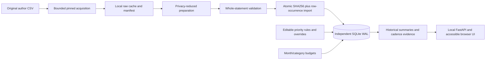

# Architecture

`app/imports.py` validates bounded UTF-8 CSV before database mutation. One immediate SQLite transaction serializes deduplication and insertion. Byte fingerprints make exact statement imports idempotent, while per-statement row indices preserve identical valid rows. Overlapping different exports are intentionally not fuzzy-merged. Original sources and preparation hashes remain in the local manifests; no source data are bundled into the image.

`app/db.py` owns schema, deterministic rule precedence (priority descending, ID ascending), fallback classifications and reclassification. Manual overrides take precedence. Schema v2 corrects untouched initial transfer defaults while preserving user-edited rules and overrides. FPO/FPI mechanics do not prove ownership: unreviewed outbound transfers count as spending. SQLite WAL, constraints and per-request connections are sufficient for this single local workflow; Postgres would add a service without a demonstrated need.

`app/analysis.py` produces exact integer cashflow/category totals, month/category alert state and explicitly heuristic recurrence. Amount sorting/clustering is bounded by the import cap; repeated median scans were removed. Distinct dates, stable amounts and a measured fraction of compatible intervals support candidates. Historical next-date estimates are not present obligations. There is no model or trained classifier.

`app/main.py` validates API payloads and configuration, bounds request bytes before multipart spooling, restricts Host and browser mutation origins, uses parameterized SQL and sets a restrictive local-asset CSP. Native UI code uses DOM text insertion, meaningful form labels and tabular chart equivalents. Request sequencing suppresses stale view renders. Committed imports retain receipts even if the subsequent view refresh fails.

Docker source is on the host. A digest-pinned Python base and hash-pinned runtime requirements produce one nonroot container with a read-only root, limited tmpfs, no added capabilities, memory/CPU/PID limits, unique project bridge and database volume. Its port binds only 127.0.0.1. An initial internal bridge yielded no activated published port on this engine; only this project's network/container were recreated to correct it, retaining data and unrelated services. No cloud storage, Git operations or publication occurred.

See DECISIONS.md for actual experiments/failures/fixes, DATA_SOURCES.md for source limits, UPSTREAM.md for references, and VERIFICATION.md for observed validation. No architectural choice establishes production or multiuser readiness.
